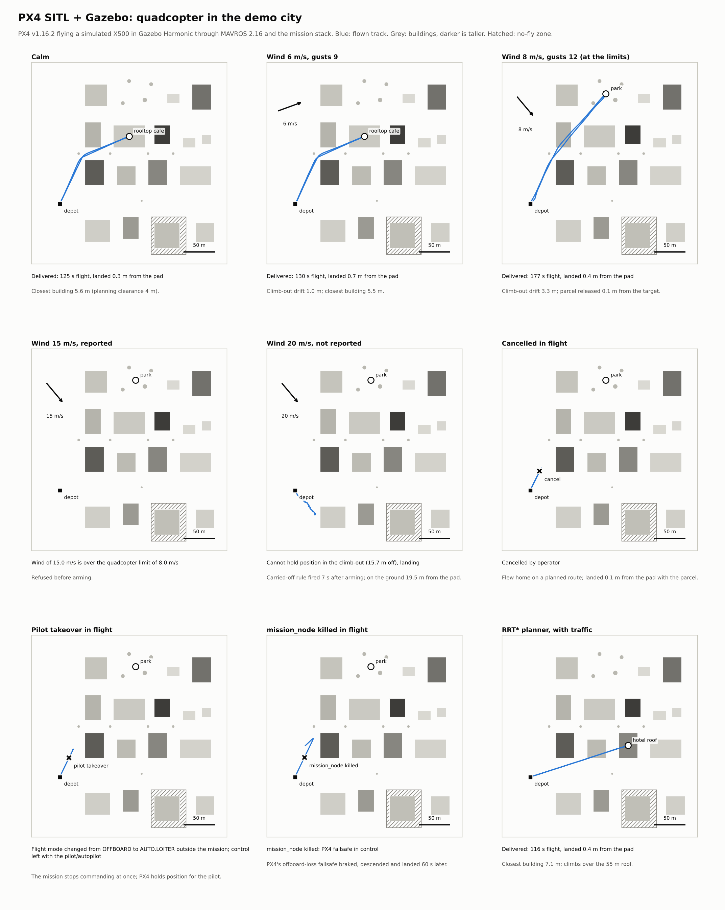
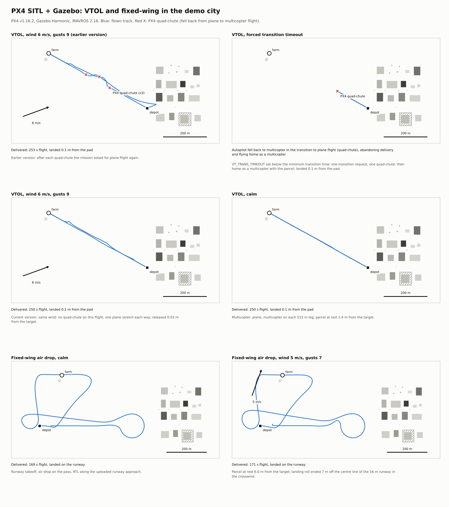
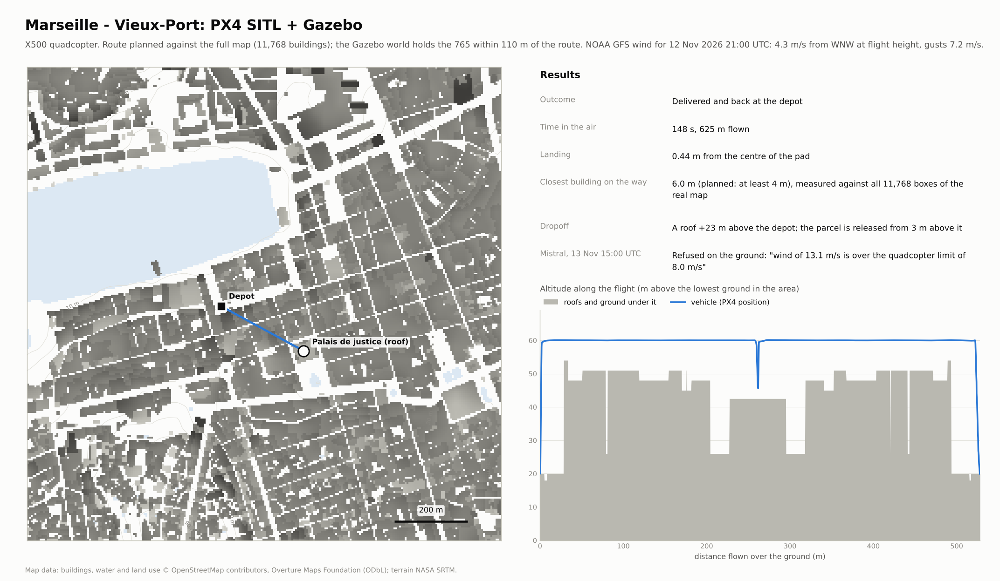
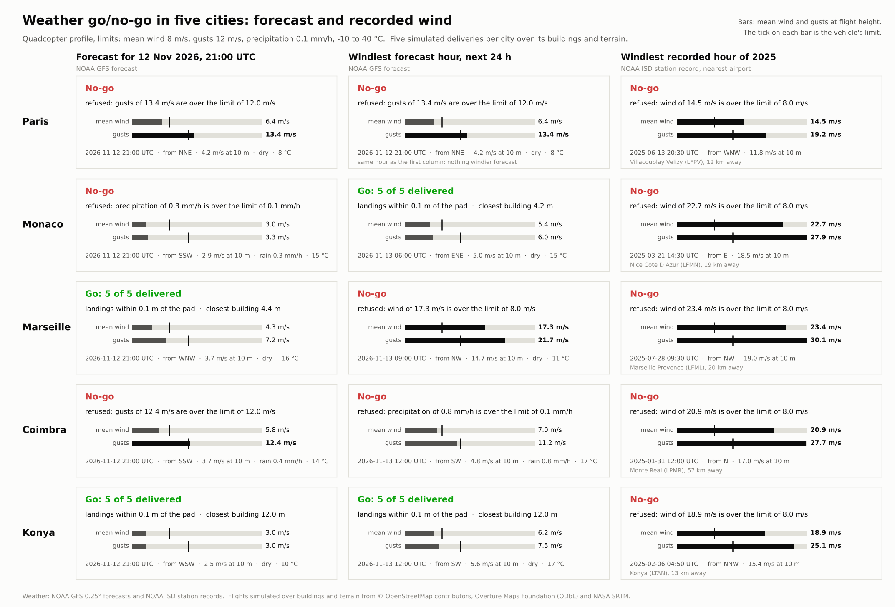
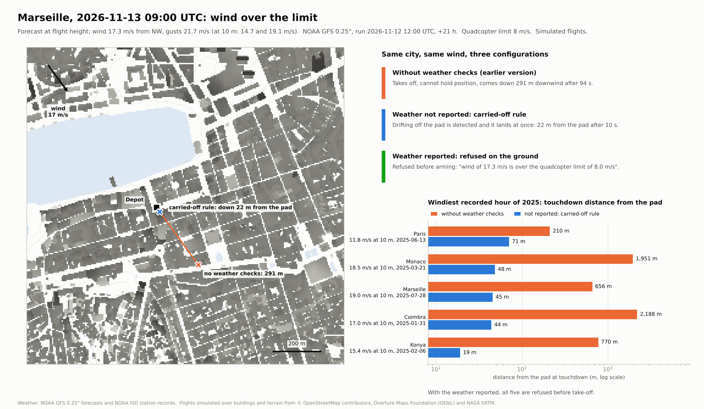
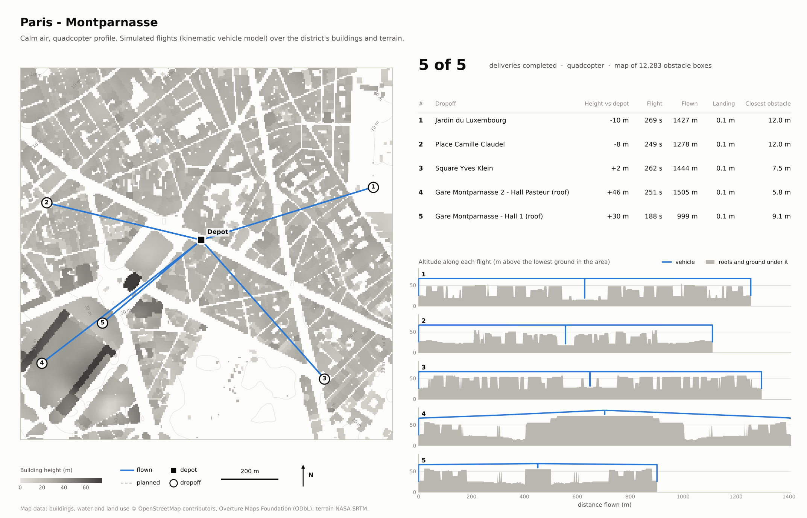
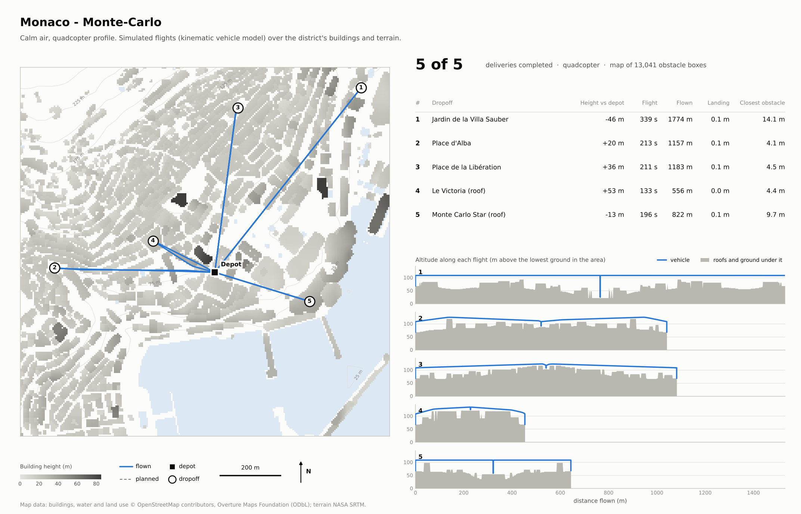
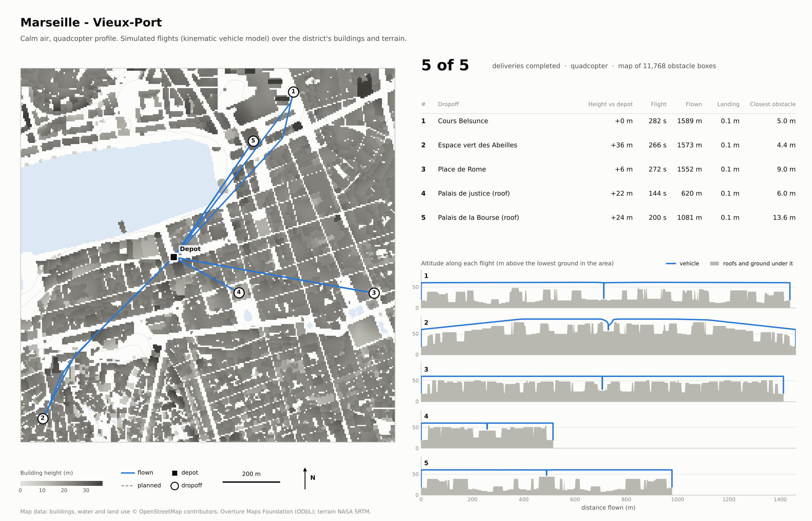
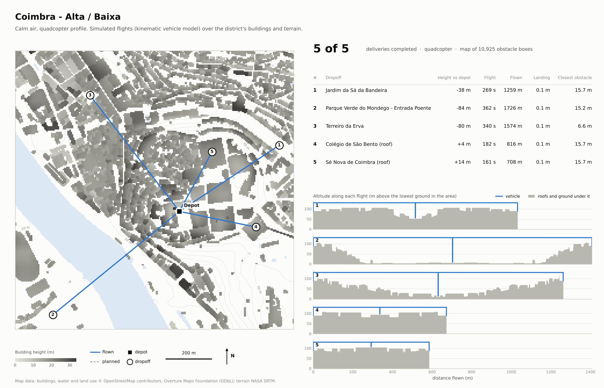
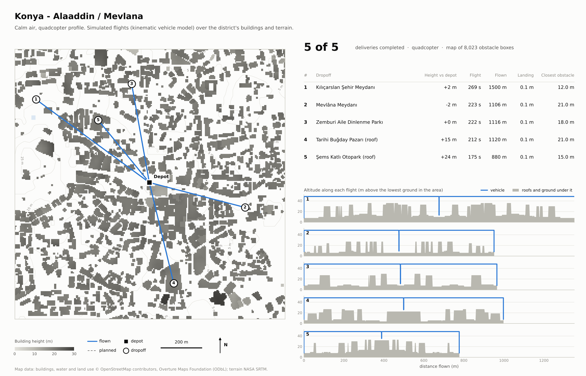

# Autolivery-Drone

Autonomous parcel delivery for PX4 drones and planes, on ROS 2.

Licensed under the [PolyForm Noncommercial License 1.0.0 with Additional Conditions](LICENSE.md). Commercial use, military use and use in weapons are all forbidden. Anyone else who shares or publishes it, or anything made with it, must credit it. Experimental and tested in simulation only: read the [safety notice](#safety-notice) before flying it.

A delivery is one action goal: the vehicle checks the weather against its limits, plans a route through the city (A* or RRT*), takes off, flies it in PX4 offboard mode through MAVROS, dodges other traffic on the way, drops the parcel (hover, winch, landing or air drop), flies home and lands. Everything is simulated in a Gazebo city generated from the same map the planner flies against.

## Results

All of these are simulated flights. The PX4 ones run the actual PX4 autopilot (SITL) in Gazebo; the city ones fly a kinematic model of the vehicle over the real buildings and terrain of five districts. Details and the full list of runs are under [Verified in PX4 SITL + Gazebo](#verified-in-px4-sitl--gazebo) and [The city map](#the-city-map).











<details>
<summary>Five city districts flown in calm air</summary>











</details>

Map data in the city pictures: contains information from [OpenStreetMap](https://www.openstreetmap.org/copyright) and [Overture Maps](https://overturemaps.org), which is made available here under the [Open Database License (ODbL)](https://opendatacommons.org/licenses/odbl/1-0/); © OpenStreetMap contributors, Overture Maps Foundation. Terrain: NASA SRTM. Weather: NOAA. How the map data was converted: [docs/images/MAP-DATA.md](docs/images/MAP-DATA.md).

## Architecture

```
Deliver goal -> mission_node -> Mission (autolivery_core) -> setpoints (20 Hz) -> MAVROS -> PX4
                    ^               |  plan:  A* / RRT* over the city map, shortcut smoothing
                    |               |  fly:   carrot path follower + velocity-obstacle avoidance
                    |               |  drop:  hover / winch / land / air drop (ballistic lead)
                    |               |  guard: weather, takeover, disarm, battery, lost link,
                    |               |         timeouts, geofence
                    |               +-> payload_node -> MAVLink gripper cmd | Gazebo DetachableJoint
   MAVROS state, pose, battery, extended state, wind estimate, payload state,
   /autolivery/weather, /autolivery/obstacles
          ^                   ^                ^
   station / forecast   adsb_traffic_node   sim_traffic, sim_weather (Gazebo)
```

The decision-making lives in `autolivery_core`, a plain C++17 library with no ROS in it. The nodes only translate, so the whole delivery (takeoff to touchdown, including every failure path) is unit tested against a kinematic PX4 stand-in in milliseconds.

## Repository layout

```
ros2_ws/src/
  autolivery_core/        C++ library: world map, voxel grid, A*, RRT*, smoothing, path
                          follower, velocity-obstacle avoidance, vehicle profiles, gripper
                          commands, the Mission state machine, KinematicVehicle (fake PX4)
  autolivery_interfaces/  Deliver action, PlanPath service, MissionStatus / Obstacle / Payload /
                          Weather msgs
  autolivery_drone/       ROS 2 nodes, launch files, vehicle + gripper configs, city map
    src/  mission_node, payload_node, planner_node, adsb_traffic_node, fake_fcu_node
    config/vehicles/      quadcopter, hexacopter, octocopter, coaxial_octocopter,
                          helicopter, vtol, fixed_wing
    config/grippers/      simulated, mavlink_gripper, servo, electromagnet, winch
    maps/urban_delivery.yaml   the city: geofence, buildings, trees, masts, no-fly zones,
                               depots, named dropoffs, simulated traffic
  autolivery_gazebo/      Gazebo world (generated from the map), PX4 vehicle + parcel models,
                          sim_traffic_node, sim_weather_node, sim.launch.py
.github/workflows/ci.yml  build + all tests in ros:jazzy
```

## Vehicles and grippers

| Profile | Class | Dropoff | Wind / gust limit | PX4 airframe | Gazebo |
|---|---|---|---|---|---|
| `quadcopter` | multicopter | hover, 3 m | 8 / 12 m/s | 4001 (x500) | yes |
| `hexacopter` | multicopter | winch, 12 m | 10 / 14 m/s | 6001 | - |
| `octocopter` | multicopter | land | 8 / 12 m/s | 8001 | - |
| `coaxial_octocopter` | multicopter | hover, 4 m | 8 / 12 m/s | 12001 | - |
| `helicopter` | multicopter | winch, 15 m | 10 / 15 m/s | 16001 | - |
| `vtol` | vtol | hover, 4 m (FW cruise on long straight stretches) | 8 / 12 m/s | 4004 (standard_vtol) | yes |
| `fixed_wing` | fixed-wing | air drop, 30 m, from the airstrip | 8 / 12 m/s | 4003 (rc_cessna) | yes |

Any airframe PX4 flies works: pick the closest profile and tune its numbers. Profiles are validated at startup (a fixed-wing with a hover dropoff, a clearance smaller than the airframe, a wind limit the vehicle could not fly against, etc. refuse to start). The weather limits shipped here are placeholders for the simulated airframes: take the real ones from your airframe's manual.

| Gripper | How it is driven | Release confirmed by |
|---|---|---|
| `simulated` | Gazebo DetachableJoint via ros_gz_bridge | the joint's own state |
| `mavlink_gripper` | `MAV_CMD_DO_GRIPPER` (PX4 payload deliverer) | timing (or a sensor) |
| `servo` | `MAV_CMD_DO_SET_ACTUATOR` on "Peripheral via Actuator Set N" | timing (or a sensor) |
| `electromagnet` | `MAV_CMD_DO_SET_ACTUATOR`, energised to hold | timing (or a reed switch) |
| `winch` | `MAV_CMD_DO_WINCH` deliver / lower, then retract + lock | timing incl. pay-out |

A payload sensor (limit switch, load cell) on `payload_sensor_topic` (`std_msgs/Bool`) turns on sensor-based confirmation and retries (`mission.payload_feedback: true`).

## Weather

Every profile says what weather its airframe may fly in: `max_wind`, `max_gust`, `max_precipitation`, `min_temperature`, `max_temperature`. The mission holds whatever it is told about the weather against them:

- **On the ground** a delivery in weather outside the limits is refused, with the reading and the limit: `wind of 15.0 m/s is over the quadcopter limit of 8.0 m/s`. If the weather turns after a delivery was accepted but before the motors start, the vehicle stands down.
- **In flight**, weather that stays outside the limits for `mission.weather_abort_after` (5 s) abandons the delivery and the vehicle flies home by a planned route. A release already under way is finished first.
- **Landed at a dropoff** (land deliveries), the vehicle sits bad weather out on the ground rather than take off into it, and stays there if it does not pass.

The weather comes from outside, on `/autolivery/weather` (`autolivery_interfaces/msg/Weather`: mean wind speed and the direction it blows from, strongest gust, precipitation, temperature; NaN for whatever is not measured). A station at the depot, a forecast feed or the operator publishes it:

```bash
ros2 topic pub -r 1 /autolivery/weather autolivery_interfaces/msg/Weather \
    "{wind_speed: 6.0, wind_direction: 320.0, wind_gust: 9.0, precipitation: 0.0, temperature: 12.0}"
```

A report older than `weather_timeout` (120 s) is no report. Without one, deliveries fly unchecked and the log says so; `mission.require_weather_report: true` refuses them instead. The limits are meant for the wind at flight height, and a 10 m mast in a city reads well under that. In flight the autopilot's own wind estimate (`/mavros/wind_estimation`) counts as well when PX4 has one: planes and VTOLs do, multirotors only with EKF2 drag fusion set up.

With a wind in hand the mission also plans with it: a leg into the wind gets the time it needs instead of a still-air deadline, and range is checked against the air the route takes, not the ground it covers (`route is 1140 m (1420 m of air in this wind) but quadcopter range is 1200 m`).

## Setup

Ubuntu 24.04, ROS 2 Jazzy, Gazebo Harmonic, PX4 v1.16.

```bash
sudo apt install ros-jazzy-mavros ros-jazzy-mavros-extras ros-jazzy-ros-gz
# MAVROS needs the geoid dataset, or it aborts at startup:
sudo /opt/ros/jazzy/lib/mavros/install_geographiclib_datasets.sh

cd ros2_ws
rosdep install --from-paths src --ignore-src -y
colcon build
source install/setup.bash
```

RViz is optional and not pulled in by `rosdep`: `sudo apt install ros-jazzy-rviz2` if you want `rviz:=true`.

For simulation, also build PX4 SITL once:

```bash
git clone --recursive --branch v1.16.2 https://github.com/PX4/PX4-Autopilot.git ~/PX4-Autopilot
cd ~/PX4-Autopilot && make px4_sitl
export PX4_DIR=~/PX4-Autopilot
```

## Build and test

```bash
cd ros2_ws
colcon build
colcon test && colcon test-result --verbose
```

What the tests cover:

- **autolivery_core**: map geometry (exact segment/box/cylinder tests), voxel inflation, A* and RRT* (optimality, determinism, time budget, failure messages), smoothing, path following, avoidance (simulated head-on, crossing, descending and hovering encounters keep separation), profile validation, gripper MAVLink mapping, and full mission scenarios for every vehicle class and dropoff method, plus:
  - what can go wrong with the vehicle: low and critical battery, pilot takeover, autopilot failsafe, disarm in flight, the link or the position dropping out in flight (briefly, and for good), vehicle never ready, problems that only show once the vehicle connects, a VTOL autopilot giving up on plane flight (quad-chute) on the way out, on the way back or already cruising as a plane;
  - what can go wrong with the parcel: a stuck gripper, a release command that is refused or never answered, an air drop that has to go around;
  - what can go wrong with the route: corners next to a building (not cut into the planned clearance, not swung wide of), a VTOL that may only be a plane on straight stretches, cruise altitudes that need more time than the default deadlines, head-on traffic, cancel in flight and on the ground;
  - the weather: every limit refused on the ground, weather turning before the motors start, wind picking up in flight, one bad reading that passes, a squall over the dropoff, being carried off the pad on the climb-out, a land delivery sitting a squall out, deadlines and range in a headwind, and the wind model of the fake vehicle itself.
- **autolivery_drone**: the shipped city map loads, every vehicle profile validates, the quadcopter can deliver to every named location, the runway approach is flyable, RRT* falls back to A* and plans from inside a clearance margin, message, weather and geodetic conversions, the setpoint stream is kept alive while a route is planned; every shipped profile flies a whole delivery in the shipped city against the fake vehicle (catches a profile that plans but cannot be flown, e.g. a turn radius that never closes on a waypoint); a node whose teardown hangs still exits in time with the right status (after SIGINT, SIGTERM or a configuration error); every launch shows the license terms first, word for word the Required Notice in LICENSE.md, and the real-vehicle launch refuses to start until the operator has accepted them and responsibility for the flight, while the dry run and simulation never ask; and launch tests that run the real nodes against `fake_fcu`: a whole quadcopter delivery in a stiff breeze, a whole fixed-wing air drop (including the runway landing-pattern upload), a hardware-gripper delivery whose first release command the autopilot refuses, the weather limits (a gale and rain refused on the ground, wind picking up in flight bringing the parcel home), plus refusals (unknown location, no-fly zone, inside a building, already busy) and an operator cancel.
- **autolivery_gazebo**: the committed world matches the city map exactly (every collision where the planner thinks it is), PX4 sensor systems and Gazebo's wind system are loaded, vehicles are spawned on the surface the map has under their depot, parcel models fit each airframe.
- **Do the tests notice?** The rules added last (release acknowledgement, weather, corners, VTOL stretches, quad-chute) were each broken on purpose, one at a time, and the suite had to fail: a rule no test notices losing is not really tested.
- **Style**: `ament_uncrustify`, `ament_cpplint` and `ament_flake8` run as part of `colcon test`. The reference is Jazzy's apt uncrustify (0.78.1, what CI runs); newer releases indent lambda bodies differently, so reformat with that one (`ament_uncrustify --reformat`).

The fake vehicle behind the unit and dry-run tests reproduces the PX4 behaviours the mission depends on, including three found in SITL: after an AUTO.LAND touchdown PX4 disarms and reverts to the last commanded mode that allows arming (OFFBOARD), a fixed-wing RTL only lands if a mission landing pattern is loaded, and a VTOL front transition can time out and fall back to multicopter (the quad-chute).

## Run

### Dry run (no PX4, no Gazebo)

```bash
ros2 launch autolivery_drone dry_run.launch.py rviz:=true
ros2 action send_goal --feedback /autolivery/deliver \
    autolivery_interfaces/action/Deliver "{location: rooftop_cafe}"
```

`wind_speed:=6 wind_direction:=320 wind_gust:=9` blows on the fake vehicle (m/s, and the compass direction it comes from) and is reported as the weather; with `wind_speed:=15` the same goal is refused. `gripper:=mavlink_gripper gripper_rejections:=1` runs the hardware gripper path with an autopilot that refuses the first release command.

### Simulation (PX4 SITL + Gazebo)

```bash
ros2 launch autolivery_gazebo sim.launch.py vehicle:=quadcopter        # or vtol, fixed_wing
ros2 action send_goal --feedback /autolivery/deliver \
    autolivery_interfaces/action/Deliver "{location: park}"
```

`headless:=true` runs Gazebo without its GUI, `traffic:=false` removes the other aircraft, `planner:=rrt_star` switches planners, `rviz:=true` shows the map, route and active leg. `wind_speed:=6 wind_direction:=320 wind_gust:=9` makes the world windy and reports it as the weather; `weather_report:=false` blows without telling the flight stack.

### Verified in PX4 SITL + Gazebo

PX4 v1.16.2, Gazebo Harmonic (gz-sim 8.10), MAVROS 2.16, headless, one flight per row, in the shipped city unless noted. Wind is given as the direction it blows from. "Clearance" is the closest the flown track came to any building; the quadcopter plans with 4.0 m.

| Vehicle | Flight | Result |
|---|---|---|
| quadcopter (x500) | rooftop_cafe, calm | delivered, landed 0.25 m from the pad, clearance 5.6 m, 125 s |
| quadcopter | rooftop_cafe, wind 6 m/s from 250°, gusts 9 | delivered, drifted 0.95 m on the climb-out, landed 0.70 m from the pad, 130 s |
| quadcopter | park, wind 8 m/s from 320°, gusts 12 (its limits) | delivered, released 0.07 m from the target, climb-out drift 3.3 m (8 m counts as carried off), 177 s |
| quadcopter | gale of 15 m/s, reported | refused (`wind of 15.0 m/s is over the quadcopter limit of 8.0 m/s`), never armed |
| quadcopter | storm of 20 m/s that nobody reported | `cannot hold position in the climb-out (15.7 m off), landing` 7 s after arming; on the ground 19.5 m from the pad 20 s later |
| quadcopter | storm of 24 m/s, gusts 28, that nobody reported | blown along the ground before it could lift off; the carried-off rule switched to landing 6 s after arming, 17 m from the pad, but Gazebo's wind kept pushing the vehicle, so the landing was never confirmed and the mission failed after 240 s (see known gaps) |
| quadcopter | operator cancels on the way out | flew home by its planned route, landed 0.08 m from the pad, result `canceled` |
| quadcopter | pilot switches to AUTO.LOITER on the way out | the mission ended at once and stopped streaming; PX4 held position |
| quadcopter | `mission_node` killed on the way out | PX4's offboard-loss failsafe: braked (32 m further on), descended, landed 60 s later |
| quadcopter | hotel_roof (55 m roof), RRT*, other traffic | delivered, landed 0.36 m from the pad, clearance 7.1 m, 116 s |
| quadcopter | Marseille Vieux-Port, real map, forecast evening wind 4.3 m/s from 288°, gusts 7.2 | delivered to a roof 625 m away, landed 0.44 m from the pad, clearance 6.0 m from every one of the 11,768 buildings, 148 s (Gazebo held the 765 within 110 m of the route) |
| quadcopter | Marseille, the Mistral forecast for 13 Nov, 15:00 UTC: 13.1 m/s from 325°, gusts 14.4 | refused on the ground (`wind of 13.1 m/s is over the quadcopter limit of 8.0 m/s`) |
| vtol (standard_vtol) | farm, 515 m legs, calm | delivered: multicopter, plane, multicopter on each leg; parcel at rest 1.4 m from the target, landed 0.09 m from the pad, 250 s |
| vtol | farm, wind 6 m/s from 250°, gusts 9 | first flight: PX4 quad-chuted three times (two transition timeouts, one altitude loss in a transition) and the mission asked for plane flight again each time. Re-flown with the quad-chute handling: no quad-chute that time, delivered, released 0.03 m from the target, landed 0.06 m from the pad, 250 s |
| vtol | farm, PX4's `VT_TRANS_TIMEOUT` set below its minimum transition time, so every transition times out | one request for plane flight, one quad-chute, delivery abandoned 0.3 s later; flown home as a multicopter with the parcel aboard, landed 0.11 m from the pad. PX4 then refuses to arm until rebooted |
| fixed_wing (rc_cessna) | farm air drop from the airstrip, calm | runway takeoff, released on the pass, RTL flew the uploaded runway approach, landed and disarmed on the runway, 169 s |
| fixed_wing | farm air drop, wind 5 m/s from 200°, gusts 7 | delivered: the parcel came to rest 6.0 m from the target; the landing roll ended 7 m off the centre line of the 16 m runway in the crosswind, 171 s |

In earlier runs the Gazebo rc_cessna nosed over during the rollout after an otherwise clean touchdown: PX4's attitude controller saturates the elevator on the ground before its land detector triggers, and the model's 3 cm wheels tip. That is the SITL airframe's ground handling, not the mission; see known gaps.

### Real vehicle

Read the [safety notice](#safety-notice) first: everything below is at the operator's own risk.

```bash
ros2 launch autolivery_drone autolivery.launch.py \
    vehicle:=hexacopter gripper:=winch fcu_url:=/dev/ttyACM0:921600 gcs_url:=udp://@10.0.0.2 \
    accept_risk:=true
```

`accept_risk:=true` is required: with it the operator confirms having read the safety notice and the [license](LICENSE.md), accepts them, and takes sole responsibility for the flight, and the launch log records that. Without it the launch prints the notice and starts nothing. Every launch, the dry run and the Gazebo simulation included, first prints the license terms; only a real vehicle needs `accept_risk:=true`.

Power the vehicle up on its depot pad (the autopilot's local origin is taken to be the depot), connect a ground station, and fly the first missions with a safety pilot on the RC transmitter: switching out of OFFBOARD hands control back immediately (see below).

Fixed-wings need a `runways` entry for their depot in the map. `mission_node` uploads it to PX4 as a mission landing (`DO_LAND_START`, loiter down to the approach altitude, straight-in `NAV_LAND`) as soon as MAVROS connects, and refuses deliveries until PX4 has accepted it; the flight ends with RTL, which flies that approach (`RTL_TYPE 1`, the PX4 fixed-wing default). Keep the glide slope under the airframe's `FW_LND_ANG`. Without a runway the plane falls back to PX4's circular `AUTO.LAND`.

`sim.launch.py` changes two PX4 parameters in simulation only: `NAV_DLL_ACT 0` (there is no ground station) and `FW_LND_USETER 0` (the Gazebo plane has no rangefinder, and PX4 aborts terrain-referenced landings without one). Real vehicles keep the airframe defaults: a GCS link, and a rangefinder on planes.

PX4 parameters to set on purpose before flying over a city:

- **Offboard loss** (`COM_OBL_RC_ACT`, `COM_OF_LOSS_T`): what PX4 does if the companion computer or `mission_node` dies in flight. With SITL defaults and no RC it brakes, then descends and lands where it is (measured: stopped 32 m further on, on the ground 60 s later). Over buildings that spot is a matter of luck; a return at an altitude that clears every roof (`RTL_RETURN_ALT`), or a hold with a pilot standing by, is a decision to make per site.
- **Wind** (`COM_WIND_MAX`, `COM_WIND_WARN`): PX4's own wind limit, as a second layer under the mission's.
- **Geofence** (`GF_*`): the same box as the map's `geofence`, so PX4 enforces it even if the mission is wrong.

### Deliveries

```bash
# A named location from the map
ros2 action send_goal /autolivery/deliver autolivery_interfaces/action/Deliver "{location: hotel_roof}"
# An explicit point; snap_to_surface takes the drop height (ground or roof) from the map
ros2 action send_goal /autolivery/deliver autolivery_interfaces/action/Deliver \
    "{dropoff: {x: 120.0, y: 175.0}, snap_to_surface: true}"
# Check a route without flying it
ros2 service call /autolivery/plan_path autolivery_interfaces/srv/PlanPath \
    "{start: {x: 0, y: 0, z: 40}, goal: {x: 215, y: 78, z: 40}, planner: rrt_star}"
# Live state
ros2 topic echo /autolivery/mission/status
```

Refused deliveries come back as an aborted result with the reason (`the descent to the dropoff is blocked by park_tree_2`, `route is 9120 m but quadcopter range is 6000 m`, ...). Cancelling a goal in flight flies the vehicle home by a planned route and lands it.

## Safety behaviour

- **Everything is checked before the motors start**: the weather, takeoff corridor, the whole route out and back, the descent corridor over the dropoff, range, battery and parcel presence. Anything that fails is refused with a reason, and what could not be seen when the goal arrived (a vehicle that had not connected yet) is checked again before arming.
- **The autopilot outranks the mission.** If the flight mode leaves OFFBOARD without the mission asking (pilot takeover, PX4 geofence/RC/datalink/battery failsafe), the mission ends at once, stops streaming setpoints and stops requesting modes, so switching back to OFFBOARD later cannot send the vehicle to a stale target.
- **Weather**: outside the airframe's limits a delivery is refused, or abandoned and flown home if it is already under way (see [Weather](#weather)).
- **Carried off**: whatever the weather report says, a hovering vehicle that is more than twice its planning clearance from the spot it was told to hold, for 2 s, is not left to drift until a deadline. On the climb-out it lands at once; over a dropoff it climbs back out and goes home with the parcel.
- **Battery**: below `battery_return` the delivery is abandoned and the vehicle flies home by a planned route; below `battery_land` it lands where it is.
- **Every wait has a deadline** (mode change, arming, climb, settle, release, each leg, landing), sized to the height and distance involved and to the wind in hand. Aborts fly home by a planned route; the autopilot's straight-line RTL is only the last resort when no route can be planned.
- **A parcel only counts as delivered when the release was acknowledged** (or sensed). A gripper command that is refused or never answered is retried; if it keeps failing, or a sensor says the parcel is still there, the vehicle brings it home. A plane whose air drop did not release flies a pattern and makes another pass.
- **Stale data is missing data**: a pose older than 0.5 s or a state older than 2 s is not trusted. Before takeoff that means "not ready". In flight the vehicle is held where it is, and if the data stays away for `telemetry_timeout` (3 s) the mission ends and leaves the vehicle to the autopilot's own failsafe.
- **VTOL quad-chute**: PX4 gives up on a front transition that does not build airspeed in time, or on plane flight that goes wrong, comes back as a multicopter and flags its fixed-wing side as failed. Under OFFBOARD it only warns (`COM_QC_ACT` acts in its own AUTO modes), so the mission reacts: it never asks for plane flight again on that flight, brings a parcel still aboard home as a multicopter, and after the dropoff flies the rest of the way as one. PX4 will not arm again until it has been rebooted.
- **Corners**: the vehicle steers for a point ahead on its route, which cuts corners. Where the straight line to that point would come inside the planned clearance the point is pulled in, and corners are slowed down for in proportion to the turn, so the clearance the planner kept is the clearance flown. A VTOL is a plane only along straight stretches and takes every corner as a multicopter.
- **Planning never stalls the flight**: a route planned in the air (an abort, a go-around) is computed off the control loop while the setpoint stream is kept alive, and if RRT* cannot find a route A* is tried before giving up.
- **Traffic**: other aircraft on `/autolivery/obstacles` (ADS-B, simulated traffic, or your own perception) are avoided with a velocity-obstacle method that also refuses manoeuvres into buildings.
- **Shutdown always finishes**: Fast DDS 2.14 can livelock tearing a node's participant down when other nodes exit at the same moment (about 1 in 15 launch shutdowns), leaving it deaf to SIGINT until SIGKILL. Every node gets 3 s to tear down once shutdown starts, then exits anyway with the status it would have had, so launch, systemd and a restart are never held up by it (`autolivery_drone/node_main.hpp`). A node stopped mid-flight leaves the vehicle to PX4's offboard-loss failsafe and says so.

## The city map

`autolivery_drone/maps/urban_delivery.yaml` is the single source of truth. After editing it, regenerate the Gazebo world (the package test fails if you forget):

```bash
ros2_ws/src/autolivery_gazebo/scripts/generate_world.py \
    ros2_ws/src/autolivery_drone/maps/urban_delivery.yaml \
    ros2_ws/src/autolivery_gazebo/worlds/urban_delivery.sdf
```

For a real area, set `origin` to the depot's latitude/longitude/altitude and trace buildings, trees, masts and restricted airspace as boxes and cylinders in metres east/north of it. Terrain is boxes too: a depot or location given as `[x, y]` sits on whatever surface the map has there.

The format holds a real district. Maps built from open data (Overture Maps building footprints and heights on SRTM terrain, 8,000 to 13,000 boxes for a 1.3 km square) were used to check the stack against Paris-Montparnasse, Monaco, the Vieux-Port of Marseille, Coimbra and Konya: routes plan in 0.2 to 1.3 s, and all six hovering profiles delivered to five real addresses in each city against the fake vehicle (150 of 150) without coming closer to a building than their planning clearance. The same flights in the NOAA forecast wind of the day and in each city's windiest recorded hour of 2025 are where the weather limits, the carried-off rule and the corner handling come from. Those maps are not shipped: they are large, and a city changes.

## Status

| Area | State |
|---|---|
| Core planning, avoidance, mission state machine | complete, unit tested (55 mission and weather scenarios, 8 profile/city deliveries) |
| Weather limits | complete: refused on the ground, flown home from the air; unit, launch and SITL tested |
| ROS 2 nodes, launch, configs, dry run | complete, launch tested (quad, fixed-wing, hardware gripper, weather) |
| Gazebo world, wind, PX4 vehicle + parcel models | complete |
| Quadcopter delivery in PX4 SITL + Gazebo | flown end to end, incl. traffic avoidance, wind, cancel, takeover, node loss |
| VTOL delivery in PX4 SITL + Gazebo | flown end to end, incl. FW transitions, wind and a quad-chute |
| Fixed-wing air drop in PX4 SITL + Gazebo | flown end to end; sim airframe noses over on rollout |
| CI (GitHub Actions, ros:jazzy) | configured; runs build, all tests and linters |
| Hardware flight | not yet flown |

## Known gaps

- The world frame is tied to the autopilot's local origin, so the vehicle must be switched on at its depot. Dropoffs by latitude/longitude are not accepted yet (the map origin is there for ADS-B conversion).
- The weather limits act on what is reported. Nothing on board measures the wind: a multirotor on stock PX4 has no wind estimate, so between reports the only protection is the carried-off rule, which acts once the vehicle is already losing. Rain and temperature have no effect in either simulator; they are only compared with the limits.
- Wind in simulation is approximate. The fake vehicle takes a multirotor's top airspeed to be its `max_speed` and has no attitude or drag; Gazebo's wind drag is linear and about twice a real airframe's at the speeds that matter. Both err on the windy side. A landed vehicle in a simulated storm is pushed along the ground, which a real one would not survive either.
- VTOL transitions in simulated wind are not evidence either way. In 6 m/s gusting to 9, PX4 quad-chuted in one flight and not in the next. Gazebo Harmonic's lift and drag act on the moving air, but its airspeed sensor has no wind input, so PX4's airspeed in a windy simulation is not what the wing feels. Whether a real airframe would make those transitions needs flight testing; what was tested is the mission's reaction when it does not.
- One Gazebo model per map box is fine for the shipped city and too slow to load for a real square kilometre (about 10,000 boxes). Simulating a real district in Gazebo needs the route's surroundings only, or the boxes merged into a mesh.
- If `mission_node` dies in flight the vehicle is in the hands of PX4's offboard-loss failsafe, whatever that is set to (see "Real vehicle").
- Air-drop release timing assumes a drag-free fall; parachuted parcels need a drag model.
- Dynamic obstacles come only from `/autolivery/obstacles`; there is no onboard perception (lidar/depth) node yet.
- Hexacopter, octocopter, coaxial and helicopter profiles have no Gazebo model; their mission logic is the multicopter path already tested in SITL.
- Gazebo's rc_cessna has nosed over on the landing rollout (see "Verified in PX4 SITL + Gazebo"); the landing itself, detection and disarm are fine. A plane with more realistic landing gear in simulation, or real hardware, is needed to validate rollouts.
- The fixed-wing loiter-down point for the airstrip runway sits about 100 m west of the main (multirotor) depot at 40 m; with both fleets flying at once the two need separating in the map.
- The mission reports success on "landed and disarmed"; it does not yet read PX4's failure-detector state, so a hard landing that still ends disarmed counts as a completed delivery.
- `NAV_DLL_ACT` and `FW_LND_USETER` are overridden in simulation only (see "Real vehicle").

## Safety notice

This is experimental software. It has only been tested in simulation, it is not certified for any aircraft, and like any flight software it can fail in ways that crash a vehicle, drop a parcel in the wrong place, damage property or hurt people. Whoever flies it does so entirely at their own risk and is solely responsible for the vehicle, for operating it safely, and for following the aviation rules where it flies (delivery flights over towns and people need an authorisation from the aviation authority almost everywhere). Fly first in an open area, within sight, with a safety pilot ready to take over. The real-vehicle launch will not start until the operator adds `accept_risk:=true`, confirming they have read this notice and the license and accept them.

## License

Copyright (c) 2025-2026 varolkan. Licensed under the [PolyForm Noncommercial License 1.0.0 with Additional Conditions](LICENSE.md). In short (the license text is what counts):

- **Permitted**: noncommercial purposes, including personal study, research, experiment and testing, hobby projects and private entertainment, and use by charitable organisations, educational institutions, public research, public safety or health and environmental protection organisations, and government institutions, except military ones.
- **No commercial use**: nothing that earns money, or is meant to, for anyone, and no use by or for a business, internal use and evaluation included. That covers projects funded by investors, paid for by a client or sponsored by a business, even while they are still at the research or prototype stage. Commercial use needs a separate written license signed by the author.
- **No military use or weapons**: not by or for armed forces (gendarmeries and national guards included), defense ministries, military intelligence, private military companies or their contractors; not for any military purpose or military-funded work; and not in any weapon, by anyone.
- **Data mining**: training machine-learning models on it, or mining it, counts as using it.
- **Credit**: anyone allowed to use it who shares, shows or publishes it, or anything made with it, must credit it as "Based on Autolivery-Drone by varolkan (https://github.com/varolkan)", say whether they changed it, and not suggest the author endorses them. Giving credit never makes a forbidden use allowed.
- **Users carry the risk**: whoever uses it is solely responsible for what they do with it, and covers the author's costs if their use gets the author sued.
- **No second chances**: commercial, military or weapons use ends the license at once, and stopping afterwards never excuses it.
- **Passing it on**: every copy must come with the license, its Additional Conditions and the `Required Notice:` lines at the top of it, including the safety notice.
- **No warranty, no liability**: as far as the law allows, the software comes as is, without any warranty, and the author is not liable for any damages arising from its use.

Using the software means accepting these terms, and every launch, real or simulated, starts by printing them.

The pictures in `docs/images` are covered by the same license. The map data in the city pictures stays under its own license, the ODbL; see [docs/images/MAP-DATA.md](docs/images/MAP-DATA.md).
